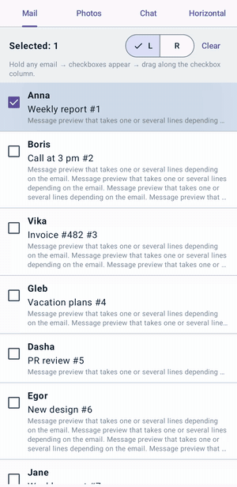
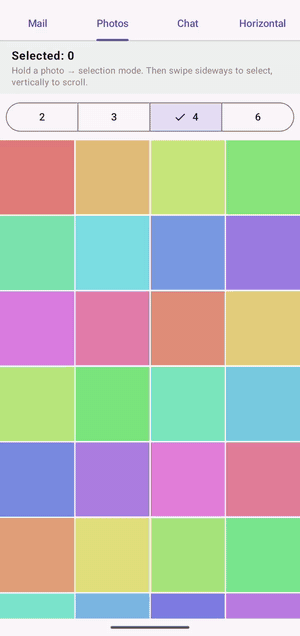

<h1 align="center">SwipeSelect for Jetpack Compose</h1>

<p align="center">
  <b>Swipe to multi-select for Compose lazy lists and grids.</b><br>
  Hold, drag your finger, and every item under it gets selected. The list auto-scrolls at the edges.
</p>

<p align="center">
  <a href="https://jitpack.io/#Mironlive/swipe-select-compose"></a>
  
  <a href="https://github.com/Mironlive/swipe-select-compose/blob/main/LICENSE"></a>
</p>

<p align="center">
  
  &nbsp;
  
</p>

<p align="center">English · <a href="https://github.com/Mironlive/swipe-select-compose/blob/main/README.ru.md">Русский</a></p>

- **One modifier.** `LazyColumn`, `LazyRow`, `LazyVerticalGrid`, `LazyHorizontalGrid`. Items of any size.
- **Three ways to start, combinable:** an edge strip (a mail-style checkbox column), long press (Photos), swipe across (Photos in select mode).
- **Feels native.** Auto-scroll ramps up towards the edge. Moving back restores what was there before the gesture.
- **Taps stay yours.** A tap in the strip goes to your checkbox, a drag goes to the gesture. Scrolling outside the strip is untouched.
- **Chats and carousels.** `reverseLayout = true`, horizontal lists, content padding.
- **Plays well with your ViewModel.** `onChange` fires once per gesture.
- **Tiny.** Depends only on `compose-foundation`.

> Also available for [React Native](https://github.com/Mironlive/swipe-select), [Flutter](https://pub.dev/packages/swipe_select) and [SwiftUI](https://github.com/Mironlive/swipe-select-swiftui).

## Installation

`settings.gradle.kts`:

```kotlin
dependencyResolutionManagement {
    repositories {
        google()
        mavenCentral()
        maven("https://jitpack.io")
    }
}
```

`build.gradle.kts` of your app:

```kotlin
dependencies {
    implementation("com.github.Mironlive:swipe-select-compose:0.1.0")
}
```

## Quick start

```kotlin
@Composable
fun Inbox(mails: List<Mail>) {
    val selection = rememberSwipeSelectState<Long>()
    val listState = rememberLazyListState()

    LazyColumn(
        state = listState,
        modifier = Modifier.swipeSelect(selection, listState, keyForIndex = { mails.getOrNull(it)?.id }),
    ) {
        items(mails, key = { it.id }) { mail ->
            MailRow(
                mail = mail,
                selected = selection.isSelected(mail.id),
                onCheck = { selection.toggle(mail.id) },
            )
        }
    }
}
```

Two rules:

1. Put `Modifier.swipeSelect(...)` on the list and pass **the same** `LazyListState` / `LazyGridState`.
2. `keyForIndex` returns a stable key for a list index (usually the id), or `null` for items that can't be selected (headers, footers). The selection holds keys, so it survives sorting and pagination.

Items don't need any extra modifier — positions come from the list's `layoutInfo`.

By default you tap the first checkbox to enter selection mode, then drag along the 56 dp strip on the start edge.

## How the gesture starts — `activation`

```kotlin
// Edge strip (default). Like mail apps.
activation = listOf(SwipeSelectActivation.Edge(side = EdgeSide.Start, size = 56.dp))

// Long press anywhere on an item. Like Photos. No selection mode needed.
activation = listOf(SwipeSelectActivation.LongPress(durationMillis = 300))

// Swipe across the list. Like Photos in select mode: sideways selects, vertical scrolls.
activation = listOf(SwipeSelectActivation.Pan())
```

| | `Edge` | `LongPress` | `Pan` |
| --- | --- | --- | --- |
| Where | strip at the edge | the whole item | the whole item |
| Starts | after the finger moves 4 dp | after holding | on a swipe across the list |
| Default `when` | `SelectionMode` | `Always` | `SelectionMode` |
| Scrolling | outside the strip | until the hold | along the list |

`when`: `ActivationWhen.Always`, `SelectionMode` (only while selecting) or `Idle` (only outside selection mode).

### Combine them

Like a mail app — no checkboxes at first, a long press anywhere enters selection mode, then you drag along the checkbox column:

```kotlin
activation = listOf(
    SwipeSelectActivation.LongPress(`when` = ActivationWhen.Idle),
    SwipeSelectActivation.Edge(),
)
```

A photo grid without a "Select" button:

```kotlin
activation = listOf(
    SwipeSelectActivation.LongPress(`when` = ActivationWhen.Idle),
    SwipeSelectActivation.Pan(),
)
```

**Selection mode** is on while something is selected. If your app has a "Select" button, set `selection.selectionMode = true`. Hiding checkboxes outside selection mode is your UI: `selection.isSelectionMode`.

## Your ViewModel

```kotlin
val selection = rememberSwipeSelectState(
    initialSelection = uiState.selectedIds,
    onChange = { ids, reason -> viewModel.setSelected(ids) },
)

// When your state changes from the outside:
LaunchedEffect(uiState.selectedIds) { selection.sync(uiState.selectedIds) } // no onChange call
```

- During a gesture every change is published (rows update live), but `onChange` fires **once**, when the gesture ends.
- `toggle`, `select`, `deselect`, `setSelection`, `clear` also call `onChange`; `reason` tells you why: `Gesture`, `Toggle` or `Api`.

## Lists

| | |
| --- | --- |
| `LazyColumn` / `LazyRow` | works as is |
| `LazyVerticalGrid` / `LazyHorizontalGrid` | selection is linear by index, like in Photos |
| `reverseLayout = true` (chats) | works as is — auto-scroll goes to older items |
| `contentPadding`, headers, separators | works as is; return `null` from `keyForIndex` for non-items |
| Right-to-left | `EdgeSide.Start` follows the layout direction |

## Customization

```kotlin
Modifier.swipeSelect(
    selection, listState,
    keyForIndex = { mails.getOrNull(it)?.id },
    activation = listOf(SwipeSelectActivation.Edge(side = EdgeSide.End)),
    autoScroll = SwipeSelectAutoScroll(edgeSize = 80.dp, minSpeed = 150.dp, maxSpeed = 1400.dp), // or .Disabled
    enabled = !isEditing,
    isSelectable = { !mails[it].locked },                       // skipped while swiping
    onDragStart = { haptic.performHapticFeedback(HapticFeedbackType.LongPress) },
    onItemEnter = { haptic.performHapticFeedback(HapticFeedbackType.TextHandleMove) },
    onDragEnd = { println(it.selected) },
)
```

The library draws nothing: checkboxes, highlights, counters and toolbars are yours. Use `selection.isSelectionMode`, `selection.isDragging`, `selection.count`, and `selection.autoScrollDirection` (-1, 0, 1) to highlight the edge while the list auto-scrolls.

## API

### `Modifier.swipeSelect(state, listState | gridState, keyForIndex, …)`

| Parameter | Type | Default | |
| --- | --- | --- | --- |
| `state` | `SwipeSelectState<K>` | — | holds the selection |
| `listState` / `gridState` | `LazyListState` / `LazyGridState` | — | the list's state |
| `keyForIndex` | `(Int) -> K?` | — | stable key of an item, `null` = not selectable |
| `activation` | `List<SwipeSelectActivation>` | `[Edge()]` | how the gesture starts |
| `autoScroll` | `SwipeSelectAutoScroll` | `(60.dp, 120.dp, 900.dp)` | edge zone, min / max speed per second |
| `enabled` | `Boolean` | `true` | turn the gesture off |
| `isSelectable` | `((Int) -> Boolean)?` | all | non-selectable items are skipped |
| `onDragStart` / `onItemEnter` / `onDragEnd` | `(SwipeSelectEvent<K>) -> Unit` | — | index, key, mode (`Select` / `Deselect`), selection |

### `SwipeSelectState<K>` / `rememberSwipeSelectState()`

`selected`, `count`, `isSelected(key)`, `isSelectionMode`, `selectionMode` (force on / off), `isDragging`, `autoScrollDirection`, `toggle`, `select`, `deselect`, `setSelection`, `clear`, `sync`, `onChange`.

## How it works

- Positions come from `layoutInfo.visibleItemsInfo` — no per-item modifiers, no extra recompositions. The finger is matched against the visible items (the nearest one wins for gaps and padding). Lazy lists stay lazy.
- The gesture listens in the `Initial` pointer pass, before the list: the edge strip claims the pointer after 4 dp (the list needs its touch slop), long press after the hold, swipe-across when the finger moves across first. Once claimed, events are consumed, so the list doesn't scroll and items don't get clicks.
- Selection is a transition between ranges `[anchor..finger]`: entering the range applies the mode, leaving it restores the snapshot taken when the gesture started. Only the difference between ranges is touched.
- Auto-scroll runs on `withFrameNanos` and `scrollBy`, respecting `reverseLayout` and the orientation.

## Limitations

- Index order must match visual order (regular lists and grids). Staggered grids aren't supported.
- One `swipeSelect` per list; scrollables nested inside items aren't supported.

## Sample

[`sample/`](https://github.com/Mironlive/swipe-select-compose/tree/main/sample) — mail (long press → checkboxes, left / right strip), photo grid (10,000 items, 2–6 columns), chat (`reverseLayout`), horizontal list.

```bash
./gradlew :sample:installDebug
```

## Author

Made by Mironov · [@Mironlive](https://github.com/Mironlive)

## License

MIT
