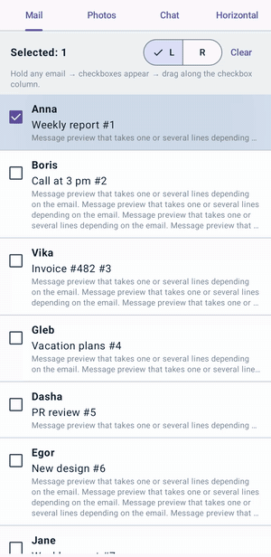
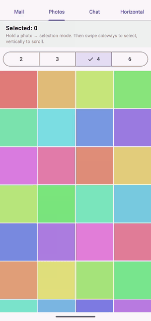

<h1 align="center">SwipeSelect for Jetpack Compose</h1>

<p align="center">
  <b>Множественный выбор свайпом для ленивых списков и сеток Compose.</b><br>
  Зажми, веди пальцем — всё, что под ним, выбирается. У краёв список прокручивается сам.
</p>

<p align="center">
  <a href="https://jitpack.io/#Mironlive/swipe-select-compose"></a>
  
  <a href="https://github.com/Mironlive/swipe-select-compose/blob/main/LICENSE"></a>
</p>

<p align="center">
  
  &nbsp;
  
</p>

<p align="center"><a href="https://github.com/Mironlive/swipe-select-compose#readme">English</a> · Русский</p>

- **Один модификатор.** `LazyColumn`, `LazyRow`, `LazyVerticalGrid`, `LazyHorizontalGrid`. Элементы любого размера.
- **Три способа начать, можно комбинировать:** полоса у края (колонка чекбоксов как в почте), долгое нажатие (Фото), свайп поперёк (Фото в режиме выбора).
- **Как в системе.** Автоскролл ускоряется к краю. Если вести палец назад, возвращается то, что было до жеста.
- **Тапы остаются твоими.** Тап в полосе попадает в твой чекбокс, протяжка — в жест. Скролл вне полосы не трогается.
- **Чаты и карусели.** `reverseLayout = true`, горизонтальные списки, content padding.
- **Дружит с ViewModel.** `onChange` вызывается один раз за жест.
- **Лёгкая.** Зависит только от `compose-foundation`.

> Есть версии для [React Native](https://www.npmjs.com/package/@mironlive/react-native-swipe-select), [Flutter](https://pub.dev/packages/swipe_select) и [SwiftUI](https://github.com/Mironlive/swipe-select-swiftui).

## Установка

`settings.gradle.kts`:

```kotlin
dependencyResolutionManagement {
    repositories {
        google()
        mavenCentral()
        maven("https://jitpack.io")
    }
}
```

`build.gradle.kts` приложения:

```kotlin
dependencies {
    implementation("com.github.Mironlive:swipe-select-compose:0.1.0")
}
```

## Быстрый старт

```kotlin
@Composable
fun Inbox(mails: List<Mail>) {
    val selection = rememberSwipeSelectState<Long>()
    val listState = rememberLazyListState()

    LazyColumn(
        state = listState,
        modifier = Modifier.swipeSelect(selection, listState, keyForIndex = { mails.getOrNull(it)?.id }),
    ) {
        items(mails, key = { it.id }) { mail ->
            MailRow(
                mail = mail,
                selected = selection.isSelected(mail.id),
                onCheck = { selection.toggle(mail.id) },
            )
        }
    }
}
```

Два правила:

1. Повесь `Modifier.swipeSelect(...)` на список и передай **тот же** `LazyListState` / `LazyGridState`.
2. `keyForIndex` возвращает стабильный ключ по индексу (обычно id) или `null` для невыбираемых элементов (заголовки, футеры). Выбор хранит ключи, поэтому переживает сортировку и пагинацию.

Элементам ничего вешать не нужно — позиции берутся из `layoutInfo` списка.

По умолчанию: тапаешь первый чекбокс — включается режим выбора, дальше ведёшь по полосе 56 dp у левого края.

## Как начинается жест — `activation`

```kotlin
// Полоса у края (по умолчанию). Как в почте.
activation = listOf(SwipeSelectActivation.Edge(side = EdgeSide.Start, size = 56.dp))

// Долгое нажатие на элемент. Как в Фото. Режим выбора не нужен.
activation = listOf(SwipeSelectActivation.LongPress(durationMillis = 300))

// Свайп поперёк списка. Как в Фото: вбок — выбор, вертикально — скролл.
activation = listOf(SwipeSelectActivation.Pan())
```

| | `Edge` | `LongPress` | `Pan` |
| --- | --- | --- | --- |
| Где | полоса у края | весь элемент | весь элемент |
| Старт | палец сдвинулся на 4 dp | после удержания | при свайпе поперёк |
| `when` по умолчанию | `SelectionMode` | `Always` | `SelectionMode` |
| Скролл | вне полосы | до удержания | вдоль списка |

`when`: `ActivationWhen.Always`, `SelectionMode` (только в режиме выбора) или `Idle` (только вне его).

### Комбинации

Как в почте: сначала чекбоксов нет, долгое нажатие включает режим выбора, дальше ведёшь по колонке чекбоксов:

```kotlin
activation = listOf(
    SwipeSelectActivation.LongPress(`when` = ActivationWhen.Idle),
    SwipeSelectActivation.Edge(),
)
```

Сетка фото без кнопки «Выбрать»:

```kotlin
activation = listOf(
    SwipeSelectActivation.LongPress(`when` = ActivationWhen.Idle),
    SwipeSelectActivation.Pan(),
)
```

**Режим выбора** включён, пока что-то выбрано. Если есть кнопка «Выбрать», ставь `selection.selectionMode = true`. Прятать чекбоксы вне режима — твой UI: `selection.isSelectionMode`.

## Своя ViewModel

```kotlin
val selection = rememberSwipeSelectState(
    initialSelection = uiState.selectedIds,
    onChange = { ids, reason -> viewModel.setSelected(ids) },
)

// Когда стейт поменялся снаружи:
LaunchedEffect(uiState.selectedIds) { selection.sync(uiState.selectedIds) } // onChange не вызывается
```

- Во время жеста каждое изменение публикуется (строки обновляются вживую), а `onChange` вызывается **один раз** — в конце жеста.
- `toggle`, `select`, `deselect`, `setSelection`, `clear` тоже вызывают `onChange`; `reason` — причина: `Gesture`, `Toggle` или `Api`.

## Списки

| | |
| --- | --- |
| `LazyColumn` / `LazyRow` | работает как есть |
| `LazyVerticalGrid` / `LazyHorizontalGrid` | выбор линейный по индексу, как в Фото |
| `reverseLayout = true` (chats) | работает — автоскролл идёт к старым элементам |
| `contentPadding`, заголовки, разделители | работает; для не-элементов верни `null` из `keyForIndex` |
| Справа налево | `EdgeSide.Start` следует направлению текста |

## Настройка

```kotlin
Modifier.swipeSelect(
    selection, listState,
    keyForIndex = { mails.getOrNull(it)?.id },
    activation = listOf(SwipeSelectActivation.Edge(side = EdgeSide.End)),
    autoScroll = SwipeSelectAutoScroll(edgeSize = 80.dp, minSpeed = 150.dp, maxSpeed = 1400.dp), // or .Disabled
    enabled = !isEditing,
    isSelectable = { !mails[it].locked },                       // пропускаются при свайпе
    onDragStart = { haptic.performHapticFeedback(HapticFeedbackType.LongPress) },
    onItemEnter = { haptic.performHapticFeedback(HapticFeedbackType.TextHandleMove) },
    onDragEnd = { println(it.selected) },
)
```

Библиотека ничего не рисует: чекбоксы, подсветка, счётчики и тулбары — твои. Есть `selection.isSelectionMode`, `selection.isDragging`, `selection.count` и `selection.autoScrollDirection` (-1, 0, 1) — подсветить край во время автоскролла.

## API

### `Modifier.swipeSelect(state, listState | gridState, keyForIndex, …)`

| Параметр | Тип | По умолчанию | |
| --- | --- | --- | --- |
| `state` | `SwipeSelectState<K>` | — | хранит выбор |
| `listState` / `gridState` | `LazyListState` / `LazyGridState` | — | стейт списка |
| `keyForIndex` | `(Int) -> K?` | — | стабильный ключ, `null` — нельзя выбрать |
| `activation` | `List<SwipeSelectActivation>` | `[Edge()]` | как начинается жест |
| `autoScroll` | `SwipeSelectAutoScroll` | `(60.dp, 120.dp, 900.dp)` | зона у края, мин / макс скорость в секунду |
| `enabled` | `Boolean` | `true` | выключить жест |
| `isSelectable` | `((Int) -> Boolean)?` | все | невыбираемые пропускаются |
| `onDragStart` / `onItemEnter` / `onDragEnd` | `(SwipeSelectEvent<K>) -> Unit` | — | индекс, ключ, режим (`Select` / `Deselect`), выбор |

### `SwipeSelectState<K>` / `rememberSwipeSelectState()`

`selected`, `count`, `isSelected(key)`, `isSelectionMode`, `selectionMode` (force on / off), `isDragging`, `autoScrollDirection`, `toggle`, `select`, `deselect`, `setSelection`, `clear`, `sync`, `onChange`.

## Как это работает

- Позиции берутся из `layoutInfo.visibleItemsInfo` — без модификаторов на элементах и лишних рекомпозиций. Палец сверяется с видимыми элементами (в зазорах и паддингах побеждает ближайший). Ленивые списки остаются ленивыми.
- Жест слушает проход `Initial` раньше списка: полоса забирает палец после 4 dp (списку нужен его touch slop), долгое нажатие — после удержания, свайп поперёк — если палец сначала пошёл поперёк. Дальше события поглощаются: список не скроллится, элементы не получают кликов.
- Выбор — переход между диапазонами `[якорь..палец]`: вошёл в диапазон — применяется режим, вышел — возвращается снимок на начало жеста. Трогается только разница диапазонов.
- Автоскролл крутится на `withFrameNanos` и `scrollBy`, с учётом `reverseLayout` и ориентации.

## Ограничения

- Порядок индексов должен совпадать с визуальным (обычные списки и сетки). Staggered-сетки не поддерживаются.
- Один `swipeSelect` на список; вложенные скроллы внутри элементов не поддерживаются.

## Пример

[`sample/`](https://github.com/Mironlive/swipe-select-compose/tree/main/sample) — почта (долгое нажатие → чекбоксы, полоса слева / справа), сетка фото (10 000 элементов, 2–6 колонок), чат (`reverseLayout`), горизонтальный список.

```bash
./gradlew :sample:installDebug
```

## Автор

Автор — Миронов · [@Mironlive](https://github.com/Mironlive)

## Лицензия

MIT
